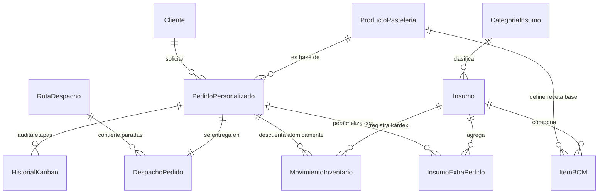
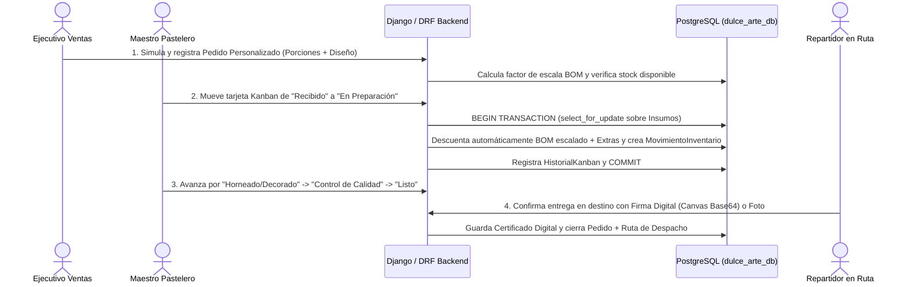
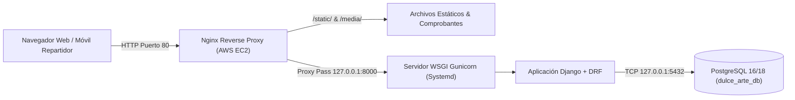

# 🎂 Dulce Arte — Sistema de Trazabilidad End-to-End y Gestión de Pedidos para Pastelería Artesanal

**Asignatura:** Desarrollo Backend — Evaluación Parcial N°3 (30%)  
**Docente:** Marcelo Alvarado Aravena  
**Proyecto Seleccionado:** **Proyecto 3 — Pastelería Artesanal "Dulce Arte"**  
**Stack Tecnológico:** Python 3 · Django · Django REST Framework (DRF) · PostgreSQL · Bootstrap 5 · HTML5 Canvas · AWS Academy EC2 (Ubuntu + Gunicorn + Nginx)

---

## 🌐 Acceso en Vivo — Despliegue en AWS EC2

| Servicio | URL en AWS EC2 | Descripción |
| :--- | :--- | :--- |
| **IP Pública AWS EC2** | `http://<TU_IP_PUBLICA_AWS_EC2>/` | *(Actualizar al iniciar laboratorio en AWS Academy)* |
| **Aplicación Web Fullstack** | `http://<TU_IP_PUBLICA_AWS_EC2>/` | Dashboard, Cotizador, Kanban, Bodega BOM y Despacho |
| **Panel Admin Integrado (En Página)** | `http://<TU_IP_PUBLICA_AWS_EC2>/administracion/` | Administración completa de los 12 modelos en una misma página |
| **Django Admin Nativo (Sin Modificar)** | `http://<TU_IP_PUBLICA_AWS_EC2>/admin/` | Administrador estándar de Django |
| **API RESTful (DRF)** | `http://<TU_IP_PUBLICA_AWS_EC2>/api/v1/` | Endpoints JSON, Simulador de Cotizaciones y Transiciones Kanban |

### 🔑 Credenciales de Prueba por Rol Operativo (Criterio 4: Seguridad y Sesiones)
Todos los usuarios de demostración utilizan la contraseña: **`dulcearte2026`**

| Usuario | Contraseña | Rol Operativo | Permisos Principales |
| :--- | :--- | :--- | :--- |
| `admin` | `dulcearte2026` | **Administrador General** | Acceso total Web, API REST y Django Admin (`/admin/`) |
| `ventas_camila` | `dulcearte2026` | **Ejecutivo de Ventas** | Clientes, Cotizador dinámico y Registro de Pedidos Personalizados |
| `chef_matias` | `dulcearte2026` | **Maestro Pastelero (Cocina)** | Tablero Kanban Digital (5 etapas) y explosión de recetas BOM |
| `bodega_pedro` | `dulcearte2026` | **Encargado de Bodega BOM** | Stock de insumos perecibles, Recetas BOM y Kardex de movimientos |
| `repartidor_lucas` | `dulcearte2026` | **Repartidor Logística** | Hojas de ruta refrigeradas y Confirmación con Firma Digital / Foto |

---

## 🏛️ Aplicación del Paradigma 4+1 de Arquitectura de Software (Kruchten)

### 1. Vista Lógica (Modelo de Dominio y Persistencia Relacional en PostgreSQL)
Estructura las 12 entidades relacionales que resuelven la desconexión entre ventas, bodega, cocina y despacho:



### 2. Vista de Procesos (Concurrencia, Transacciones Atómicas BOM y Flujo Kanban)
Garantiza la consistencia de inventario mediante transacciones atómicas (`@transaction.atomic` y bloqueo de filas `select_for_update()` en PostgreSQL) cuando un pedido avanza en el taller de cocina:



### 3. Vista de Desarrollo (Organización Modular del Código)
```text
Eva3 Backend/
├── dulce_arte_project/          # Configuración central del proyecto Django y WSGI/ASGI
│   ├── settings.py              # Conexión PostgreSQL (.env), DRF, Sesiones y Templates
│   └── urls.py                  # Enrutamiento Web, API (/api/v1/) y Django Admin (/admin/)
├── gestion_pasteleria/          # Aplicación principal del dominio Dulce Arte
│   ├── models.py                # 12 modelos relacionales + lógica transaccional BOM/Kanban/Firma
│   ├── admin.py                 # Django Admin personalizado con filtros, badges e inlines
│   ├── serializers.py           # Serializadores DRF con campos calculados
│   ├── api_views.py             # ViewSets DRF y endpoints (@action) de negocio
│   ├── views.py                 # Vistas Web Fullstack protegidas por autenticación y rol
│   ├── forms.py                 # Formularios validados con Bootstrap 5
│   ├── tests.py                 # Pruebas automatizadas unitarias y de API
│   └── management/commands/
│       └── seed_dulce_arte.py   # Poblado automático de datos demostrativos
├── templates/
│   ├── admin/                   # Personalización visual de Django Admin (base_site.html, index.html)
│   └── gestion_pasteleria/      # Interfaz responsiva (Dashboard, Kanban, BOM, Firma Digital)
├── deploy/
│   └── deploy_aws.sh            # Script automatizado de despliegue en AWS Academy EC2
├── prompts_ia.md                # Bitácora estructurada de apoyo de IA (Criterio 4)
└── requirements.txt             # Dependencias de producción
```

### 4. Vista Física / Despliegue (Infraestructura en Instancia Única AWS EC2)


### +1. Vista de Escenarios (Cobertura de las 4 Funcionalidades Clave del Caso)
1. **Cotización y Registro de Pedidos Personalizados (`/pedidos/nuevo/`)**:
   - Escalado automático de recetas según las porciones solicitadas (`factor_escala_porciones`), recargo por nivel de complejidad artística (`Estándar 1.0x`, `Personalizado 1.25x`, `Escultural 1.50x`), dedicatoria, restricciones alimentarias y simulador en vivo conectado a `POST /api/v1/pedidos/simular_cotizacion/`.
2. **Tablero Kanban Digital para el Taller de Cocina (`/cocina/kanban/`)**:
   - Tablero interactivo con las 5 columnas exactas requeridas: **`Recibido`**, **`En Preparación`**, **`Horneado/Decorado`**, **`Control de Calidad`** y **`Listo`**, operable mediante **Drag & Drop HTML5 (API DRF)** o controles rápidos.
3. **Descuento Automático de Insumos mediante Lista de Materiales - BOM (`/bodega/bom/`)**:
   - Al confirmar la entrada a cocina (`En Preparación`) o desde la ficha del pedido, el sistema descuenta de forma atómica cada insumo de la receta base (ajustado por porciones y porcentaje de merma técnica) más los ingredientes extra personalizados, registrando la trazabilidad en el Kardex (`MovimientoInventario`) y alertando sobre stocks críticos o insumos perecibles próximos a vencer.
4. **Módulo de Gestión de Rutas de Despacho con Confirmación mediante Firma Digital o Comprobante (`/logistica/rutas/`)**:
   - Planificación de hojas de ruta refrigeradas y paradas de entrega (`DespachoPedido`) con **Lienzo de Firma Digital (`<canvas>` HTML5 táctil/mouse en Base64)** y/o subida de **Comprobante Fotográfico**, registrando nombre, RUT, temperatura de entrega y coordenadas GPS.

---

## 🚀 Instrucciones de Ejecución Local

1. **Clonar el repositorio y crear el entorno virtual:**
   ```bash
   git clone https://github.com/Rena885/EVA3_Backend.git
   cd EVA3_Backend
   python -m venv venv
   # En Windows:
   .\venv\Scripts\activate
   # En Linux / macOS:
   source venv/bin/activate
   ```

2. **Instalar dependencias:**
   ```bash
   pip install -r requirements.txt
   ```

3. **Configurar variables de entorno (`.env`):**
   Copiar `.env.example` a `.env` y verificar las credenciales de tu servidor PostgreSQL local (`DB_ENGINE=postgresql`, `DB_NAME=dulce_arte_db`):
   ```bash
   cp .env.example .env
   ```

4. **Ejecutar migraciones, cargar datos demostrativos y correr pruebas:**
   ```bash
   python manage.py makemigrations
   python manage.py migrate
   python manage.py seed_dulce_arte
   python manage.py test
   ```

5. **Iniciar el servidor de desarrollo:**
   ```bash
   python manage.py runserver
   ```
   - Aplicación Web: `http://127.0.0.1:8000/`
   - Django Admin: `http://127.0.0.1:8000/admin/`
   - API REST (DRF): `http://127.0.0.1:8000/api/v1/`

---

## ☁️ Despliegue en AWS Academy EC2 (1 Comando)

1. Lanzar una instancia **Ubuntu Server 22.04 LTS o 24.04 LTS** en AWS Academy EC2 habilitando en el **Security Group** los puertos:
   - `22` (SSH)
   - `80` (HTTP)
   - `8000` (Custom TCP opcional para pruebas directas)
2. Conectarse por SSH a la instancia EC2, clonar el repositorio y ejecutar el script automatizado:
   ```bash
   git clone https://github.com/Rena885/EVA3_Backend.git
   cd EVA3_Backend
   chmod +x deploy/deploy_aws.sh
   ./deploy/deploy_aws.sh
   ```
   El script instala PostgreSQL, crea la base de datos relacional `dulce_arte_db`, detecta automáticamente la IP pública de EC2, aplica migraciones, carga los datos iniciales y deja corriendo **Gunicorn + Nginx** en el puerto 80.
